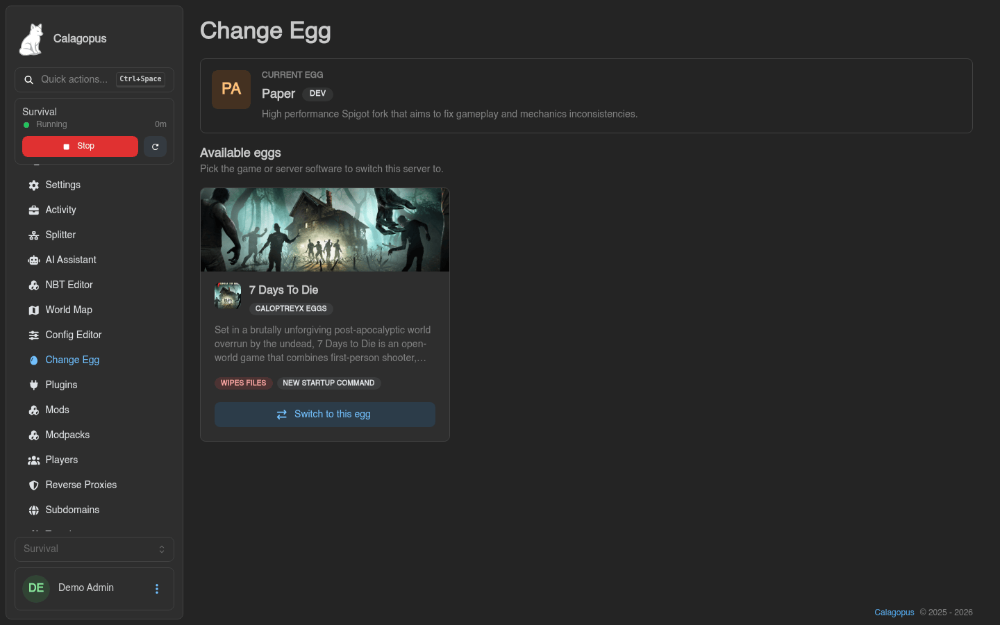
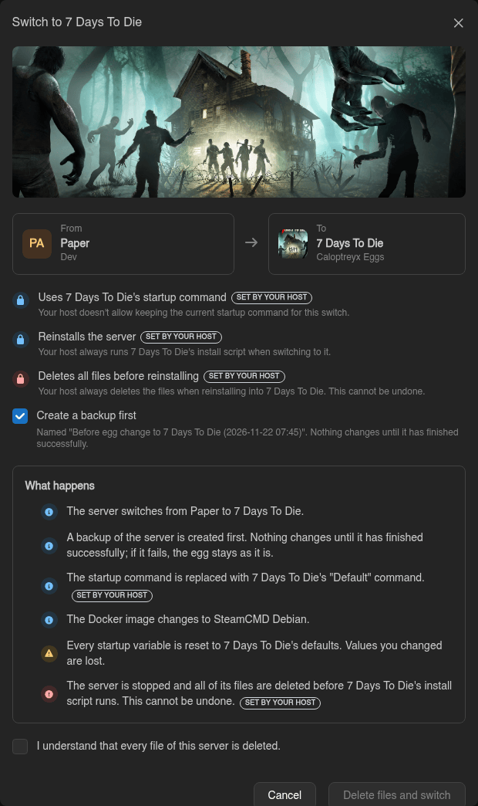
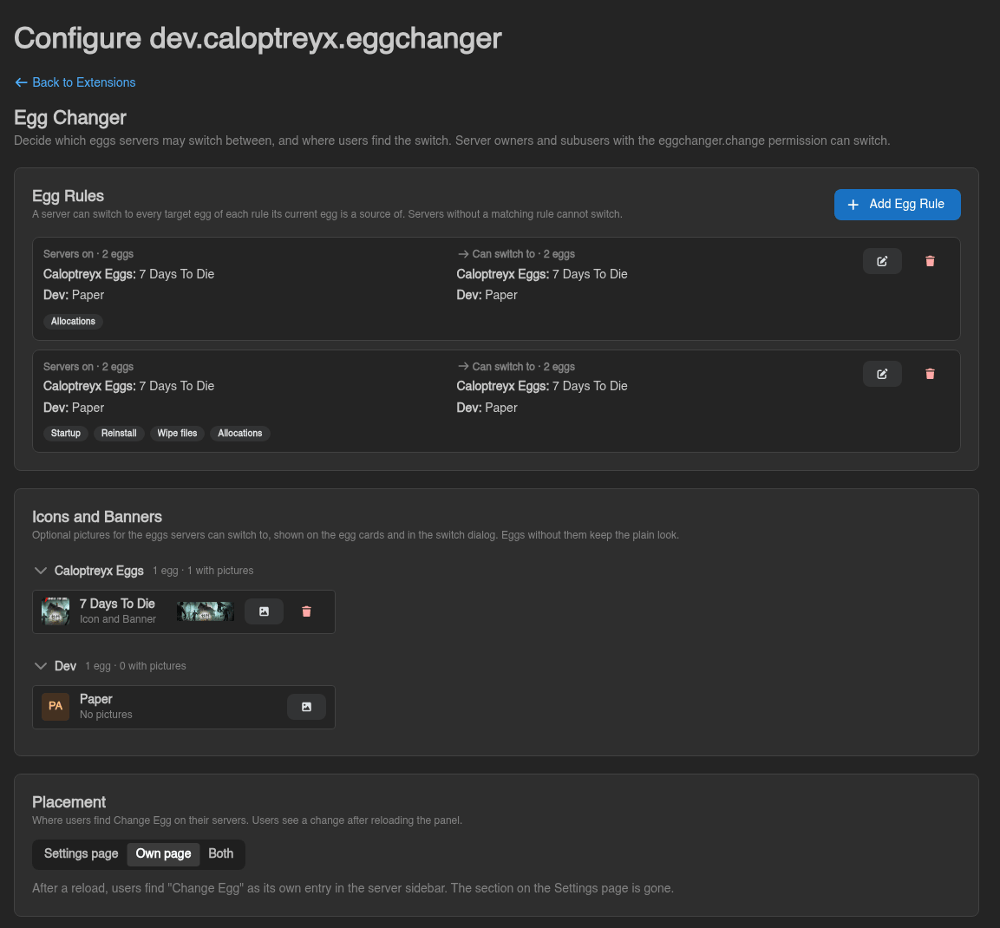

# Egg Changer

A [Calagopus Panel](https://calagopus.com) extension that lets users switch their server to another
egg themselves, for example from Minecraft Java to Minecraft Bedrock, within rules you set.

Package name: `dev.caloptreyx.eggchanger` · Requires panel `>=1.2.11`

## What your users get

- **Change Egg** where the admin's *Placement* puts it: a section at the bottom of the server's
  **Settings** page (the default, as in 1.0), a **Change Egg** page in the server sidebar, or both.
  The Settings section only appears when the user may change eggs and a rule allows at least one
  other egg for the server; the page says so when no egg is available.
- The current egg, and the eggs the server may switch to as cards with their nest, description and
  what the switch forces (reinstall, file wipe, new startup command, backup, extra ports). Search
  and a nest filter appear once there are more than six eggs or more than one nest.
- An egg's **icon** and **banner**, when the admin set them, on its card, in the switch dialog and
  in the current-egg header. Without them, or when a picture fails to load, the egg keeps the plain
  look (initials avatar, no banner).
- Pick a card, then its startup command and docker image, or keep the current startup command.
  Custom startup commands are only offered when the new egg's configuration allows them.
- Optionally **reinstall** the server with the new egg's install script, and optionally **delete
  all files** first (only together with reinstalling, and only after ticking a confirmation).
- **Create a backup first** (on by default whenever the switch reinstalls): the backup, named
  "Before egg change to *egg* (*date*)", is made through the panel's own backup system, and the
  egg only changes once it has finished successfully. If it fails, or hasn't finished within an
  hour, nothing about the server changes. The option is shown greyed out with the reason when the
  user lacks the backup permission or the server is at its backup limit.
- Options a rule forces are listed as "Set by your host" instead of switches.
- Before switching, a **What happens** list spells out the switch: the backup, the startup command
  and docker image it applies, that startup variables are reset to the new egg's defaults, how many
  ports may be added, and whether files stay, the install script runs or every file is deleted.
- Works on phones (the dialog goes full-screen) and follows the panel theme (Mint, Zoron, ...).

## What you get

- **Egg rules**: servers on a rule's source eggs may switch to its target eggs, picked from a
  nest/egg tree with search, *Select all matches* and a tick per nest to select or clear the
  whole nest. A server whose egg matches no rule can't switch. Select the same eggs on both
  sides to let servers switch freely within a group.
- **Rule options**, applied when a server switches to one of the rule's target eggs:
  - **Require a new startup command** - users can't hold on to their old startup command; one of
    the target egg's commands is always applied. Without it they may keep theirs.
  - **Always reinstall** - every switch runs the target egg's installation script.
  - **Always wipe files on reinstall** - whenever the switch reinstalls the server, its files are
    erased first.
  - **Match allocations to the new egg** (on for new rules) - applies the new egg's allocation
    deployment settings from Egg Configurations. The server keeps its primary allocation; each
    additional allocation rule (random, port range, or relative to the primary port) is satisfied
    by an allocation the server already has when one fits, otherwise by a free allocation on the
    server's node and IP. Ports are written to the variables the rules assign them to.
  - **Always back up first** - every switch first creates a backup, and only goes ahead once it
    finished successfully. Users without the backup permission or a free backup slot can't use
    the switch.

  When several rules allow the same switch, every option enabled in any of them applies, so the
  stricter rule always wins. The rule editor warns when a rule shares a switch with another one.
- **Icons and banners** per target egg: a square icon and a wide banner (shown at 3:1, cropped to
  fit). Paste an https URL, or upload a PNG, JPEG, GIF, WebP or AVIF picture (up to 5 MB) to the
  panel's own **Admin → Assets** storage, folder `egg-changer`; uploading needs the core
  `assets.upload` permission. The editor previews the pictures and the user's card. URLs must be
  `https://`, at most 1024 characters, without credentials; they are only ever rendered as
  ``. Removing a picture doesn't delete an uploaded file; do that under Admin → Assets.
- Every switch is recorded in the server's activity log as `server:eggchanger.change` with the old
  and new egg, startup command, image, reinstall options, the backup made first and newly
  assigned allocations.

## Screenshots

**Change Egg page**: the current egg and the eggs this server may switch to.

**Switch dialog**: options set by the host, the backup first, and what the switch will do.

**Admin settings**: egg rules, icons and banners, and placement.

## Installation

Download `dev_caloptreyx_eggchanger.c7s.zip` and either upload it under **Admin → Extensions** or
drop it into your heavy image's `build/extensions/` directory and `docker compose restart web`.
Extensions require the `:heavy` panel image - see the
[Calagopus docs](https://calagopus.com/docs/panel/extensions/installing-extensions).

## Configuration

**Admin → Extensions → Egg Changer → Configure**

1. **Egg Rules** - add at least one rule. *Servers on* are the eggs the rule applies to, *Can switch
   to* are the eggs those servers may switch to, *Options* control what a switch does. Each rule
   shows one line per nest ("Minecraft: All 12 eggs", "Games: Valheim, Rust and 40 more");
   *Show all eggs* lists every egg, grouped by nest. From four rules on, a search box finds the
   rules that use an egg or nest.
2. **Icons and Banners** - optional pictures for each egg servers can switch to, grouped by nest
   in sections you can fold. Big nests start folded; search by egg or nest name, filter by nest
   and by whether an egg has pictures, with counts.
3. **Placement** - *Settings page* (default: a section at the bottom of each server's Settings
   page), *Own page* (a "Change Egg" entry in the server sidebar, and no Settings section) or
   *Both*. Users see a change after reloading the panel. Egg Configurations can hide or reorder the
   page per egg like any sidebar page.
4. Give subusers the `eggchanger.change` permission where wanted. Owners and admins always have it.

Permissions: server `eggchanger.change`, plus the core permission for each part of a switch that
core guards: `settings.install` for any reinstall or wipe (also when a rule forces it),
`startup.command` for keeping the current startup command or choosing any command other than the
new egg's default, `startup.docker-image` for choosing any image other than the new egg's first,
and `backups.create` for the backup made first (also when a rule forces it; the server's backup
limit applies). New allocations count against the server's allocation limit. Admin
`extensions.eggchanger.read|write`.

## API

- `GET /api/client/servers/{server}/egg-changer` - the current egg and the eggs the server may
  switch to, each with `icon` and `banner` (https URLs or `null`), and `backup_unavailable`: why
  the user can't create a backup first, or `null`.
- `POST /api/client/servers/{server}/egg-changer` -
  `{ egg_uuid, startup?, image?, keep_startup?, reinstall?, truncate_directory?, backup_uuid? }`;
  `startup` and `image` default to the egg's default startup command and first docker image.
  `backup_uuid` is a backup of the server, created with the core backup route, that finished
  successfully within the last hour; it is required when a rule forces a backup, and the switch is
  refused (nothing changes) when the backup is missing, unfinished, failed or older.
- `GET|PUT /api/admin/extensions/dev.caloptreyx.eggchanger/settings` - `PUT` takes
  `{ placement: "settings" | "page" | "both" }`,
  `POST /api/admin/extensions/dev.caloptreyx.eggchanger/egg-rules`,
  `PUT|DELETE /api/admin/extensions/dev.caloptreyx.eggchanger/egg-rules/{id}` - rules are
  `{ eggs, allowed_eggs, options: { force_startup_update, force_reinstall, force_truncate,
  reassign_allocations, force_backup } }`,
  `PUT /api/admin/extensions/dev.caloptreyx.eggchanger/egg-appearance/{egg}` -
  `{ icon, banner }`, each an https URL or `null` to remove it.

## License

MIT
